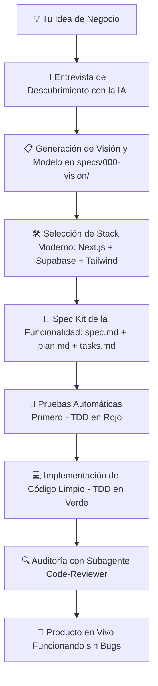

# 🚀 AI-First Startup Canvas: El Arnés Universal para Vibe Coders

[](https://github.com)
[](https://github.com)
[](https://github.com)

> **Plantilla de repositorio en blanco lista para orquestar la creación de una startup o producto digital de primer nivel utilizando agentes de Inteligencia Artificial, sin necesidad de saber programar.**

---

## 🎯 ¿Qué es este repositorio?

Este repositorio es un **lienzo en blanco pre-orquestado** que implementa los dos estándares más avanzados de la ingeniería de software moderna con IA:
1. **El Arnés del Agente (Agent Harness):** Barandillas de seguridad OWASP, reglas de arquitectura limpia, prevención de errores y subagentes auditores.
2. **Spec-Driven Development (SDD):** El método donde primero se diseña la especificación del producto en lenguaje humano (`spec.md`), luego el plano técnico (`plan.md`), luego las tareas (`tasks.md`), y finalmente se escribe código blindado con pruebas automáticas (TDD).

Cualquier modelo de lenguaje o editor de código con IA que abras (**Google Antigravity IDE, Claude Code, Cursor, OpenAI Codex, GitHub Copilot**) leerá este arnés y asumirá de inmediato el rol de tu **Director de Tecnología (CTO) y Equipo de Ingeniería Senior**.

---

## 🔄 El Flujo de Trabajo (De la Idea al Producto)



---

## ⚡ ¿Cómo usarlo en 3 sencillos pasos?

### 1. Abre el proyecto en tu editor de IA
Abre este directorio en **Antigravity IDE**, **Cursor**, **VS Code** o ejecuta **Claude Code** en la terminal.

### 2. Pega el prompt de arranque
En la ventana de chat con la IA, copia y pega este comando:

```text
Hola. Lee este repositorio, revisa AGENTS.md y empieza la entrevista inicial para crear mi producto.
```

*(En Antigravity también puedes usar los comandos `/bootstrap` o `/grill-me`)*.

### 3. Responde como Fundador (en español simple)
La IA te hará 5 preguntas estratégicas sobre tu producto:
- **Problema y Cliente:** ¿A quién ayudas y qué dolor resuelves?
- **El Momento 'Eureka':** ¿Qué acción principal hace el usuario en la app?
- **Monetización:** ¿Cómo vas a cobrar (suscripción, comisión, pago único)?
- **Datos y Seguridad:** ¿Qué datos sensibles se guardarán?
- **Servicios Externos:** ¿Qué herramientas necesitas conectar (Stripe, WhatsApp, Google OAuth)?

Con tus respuestas, la IA generará la arquitectura, configurará la base de datos y comenzará a construir tu MVP paso a paso.

---

## 🏛️ Estructura del Canvas

```
├── AGENTS.md                  # El manual maestro universal para cualquier LLM
├── CLAUDE.md                  # Configuración optimizada para Claude Code
├── .cursorrules               # Configuración optimizada para Cursor
├── .specify/                  # El motor de Spec-Driven Development (SDD)
│   └── memory/constitution.md # Principios innegociables de calidad y seguridad
├── specs/                     # Carpeta de especificaciones de producto
│   ├── 000-vision/            # Visión general y roadmap de la startup (vision.md)
│   └── templates/             # Plantillas profesionales de spec, plan y tasks
├── .claude/ (y .cursor/)
│   ├── rules/                 # Barandillas: Seguridad OWASP, Arquitectura limpia, TDD
│   ├── skills/                # Habilidades interactivas (ej. bootstrap-startup)
│   └── agents/                # Subagentes especializados (ej. code-reviewer)
└── docs/                      # Documentación viva (Arquitectura, DB, Seguridad, etc.)
```

---

## 🛡️ Barandillas de Seguridad Incluidas (Guards)

El arnés ya incluye protecciones predefinidas para que la IA nunca cometa errores graves:
- 🔒 **Cero Secretos Expuestos:** Llaves de API y credenciales van obligatoriamente en `.env`, nunca en el código.
- 💉 **Blindaje contra Inyecciones SQL:** Solo se permiten consultas parametrizadas u ORMs seguros.
- 🛡️ **Validación de Entradas:** Todo endpoint valida sus datos entrantes con esquemas estrictos.
- 🧪 **Cero Regresiones (TDD):** Ninguna tarea se considera terminada hasta que el 100% de las pruebas automatizadas pasen en verde.
- 📦 **Contratos Limpios (DTOs):** Las tablas de base de datos nunca se exponen crudas al frontend.

---

## 🤝 Las 3 Reglas de Oro para el Vibe Coder

1. **Valida el Plano Primero:** Antes de autorizar a la IA a escribir código, revisa el resumen de la especificación y confirma que resuelve lo que tu cliente necesita.
2. **Una Funcionalidad a la Vez:** No intentes construir una aplicación gigante de golpe. Avanza módulo por módulo (Autenticación ➔ Catálogo ➔ Pagos).
3. **Exige Pruebas en Verde:** Cuando la IA diga que terminó, pídele que ejecute los tests automáticos y te muestre la pantalla en vivo.
