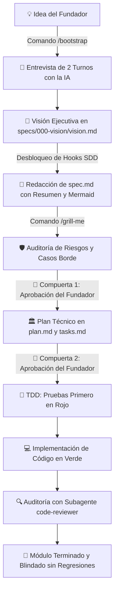

# 🚀 AI-First Startup Canvas: El Arnés Universal para Vibe Coders

[](https://github.com/GersoniaUrb/startup-agent-template)
[](https://github.com/GersoniaUrb/startup-agent-template)
[](https://github.com/GersoniaUrb/startup-agent-template)
[](https://github.com/GersoniaUrb/startup-agent-template)

> **Lienzo en blanco con arnés de agentes y Spec-Driven Development (SDD) para que cualquier persona, sin saber programar, orqueste y construya productos digitales y startups de nivel mundial.**

---

## 🎯 ¿Qué es este repositorio?

Este repositorio es una plantilla agéntica pre-orquestada que implementa la arquitectura más avanzada de la ingeniería de software moderna:
1. **El Arnés Simétrico Multi-Entorno:** Funciona de forma 100% nativa en **Google Antigravity IDE** (`.agents/`, `GEMINI.md`), **Claude Code** (`.claude/`, `CLAUDE.md`) y **Cursor** (`.cursor/`, `.cursorrules`).
2. **Gobernanza Dura con Hooks Deterministas:** Incluye scripts en Node.js que **bloquean físicamente a la IA** si intenta escribir código antes de tener la visión definida o si intenta ejecutar comandos destructivos en la terminal.
3. **Spec-Driven Development (SDD) con Compuertas de Aprobación:** La IA tiene prohibido tocar código sin una especificación y plan aprobados formalmente por el Fundador.

---

## 🔄 El Ciclo de Vida del Producto (SDLC Agéntico)



---

## ⚡ ¿Cómo usarlo? (En 3 sencillos pasos)

### 1. Clona o crea tu repo usando esta plantilla
Haz clic en el botón verde de GitHub **"Use this template"** ➔ **"Create a new repository"**, o clónalo en tu máquina:
```bash
git clone git@github.com:GersoniaUrb/startup-agent-template.git mi-startup
cd mi-startup
```

### 2. Abre tu editor de IA favorito y arranca
Abre la carpeta en **Antigravity IDE**, **Cursor** o ejecuta **Claude Code** en la terminal.  
En el chat, simplemente escribe:

```text
/bootstrap
```
*(O también: "Hola. Lee este repositorio y empieza la entrevista inicial para crear mi producto")*.

### 3. Conduce la Entrevista como Fundador
La IA ejecutará la habilidad interactiva en **2 turnos sin abrumarte**:
- **Turno 1 (Negocio):** Dolor del cliente, acción 'Eureka' y modelo de cobro (con mentalidad de socio de Y Combinator para mantener el MVP acotado).
- **Turno 2 (Riesgo y Conectores):** Datos confidenciales (seguridad) y servicios externos (Stripe, WhatsApp, Auth).

---

## 🛡️ Gobernanza Dura y Hooks Físicos

A diferencia de otros prompts que la IA puede olvidar, este canvas incluye **hooks físicos en Node.js** (`scripts/hooks/`) configurados en `.claude/settings.json`, `.cursor/hooks.json` y `.agents/hooks.json`:

| Hook | Evento | Función de Protección |
|:---|:---|:---|
| **`guard-sdd.mjs`** | `PreToolUse` (Edit / Write) | **Bloquea la escritura de código:** Si `specs/000-vision/vision.md` sigue `[EN BLANCO]`, el hook aborta la acción con código 2 impidiendo generar código prematuro. |
| **`guard-shell.mjs`** | `PreToolUse` (Bash / Shell) | **Bloquea comandos destructivos:** Impide `rm -rf`, `git push --force`, `git reset --hard`, `DROP TABLE` o lectura directa de archivos `.env`. |
| **`audit-edit.mjs`** | `PostToolUse` (Edit / Write) | **Auditoría silenciosa:** Registra cada cambio con timestamp y usuario en `.audit/edits.jsonl`. |

---

## 🛑 El Protocolo de Compuertas (Gatekeeping)

En este canvas, **el Fundador tiene el control absoluto**:
- La IA tiene prohibido pasar de `spec.md` a `plan.md` sin que el Fundador lea el **Resumen Ejecutivo (3 líneas)** y el **Diagrama Visual**, y responda afirmativamente.
- La IA tiene prohibido empezar a escribir código sin la aprobación del **Plan Técnico**.

---

## ⌨️ Comandos Agénticos Disponibles

- **`/bootstrap`**: Inicia la entrevista interactiva de 2 turnos para calibrar el MVP.
- **`/grill-me`**: Pone a prueba la especificación con 3 preguntas incisivas sobre casos borde, costos ocultos y riesgos de negocio.
- **`/plan`**: Genera la arquitectura técnica (`plan.md`) y el plan de tareas TDD (`tasks.md`).
