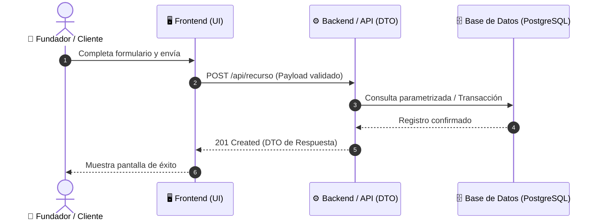

# Plan Técnico de Arquitectura: [Nombre de la Funcionalidad]

**Spec de Referencia:** `specs/[numero]-[nombre]/spec.md`  
**Rama Git Recomendada:** `feature/[nombre-feature]`

---

## 📌 Resumen Ejecutivo para el Fundador (Sin Tecnicismos)

1. **Estrategia Técnica:** [Cómo resolveremos lo pedido en la spec usando las piezas estándar del stack].
2. **Puntos de contacto:** [Qué pantallas y qué base de datos se tocarán].
3. **Garantía de calidad:** [Cómo sabremos que funciona mediante pruebas automáticas].

### 🏛️ Diagrama de Arquitectura Técnica


---

## 🗄️ 1. Modelo de Datos y Esquemas

```sql
-- Tablas involucradas con claves primarias, índices y auditoría
CREATE TABLE IF NOT EXISTS [nombre_tabla] (
    id UUID PRIMARY KEY DEFAULT gen_random_uuid(),
    [campo] VARCHAR(255) NOT NULL,
    created_at TIMESTAMP WITH TIME ZONE DEFAULT CURRENT_TIMESTAMP,
    updated_at TIMESTAMP WITH TIME ZONE DEFAULT CURRENT_TIMESTAMP
);
```

---

## 🔌 2. Contratos de API y DTOs (Data Transfer Objects)

- **Endpoint:** `POST /api/[recurso]`
  - **Body de Entrada (Validado con esquema):**
    ```json
    {
      "campoObligatorio": "valor",
      "monto": 100.00
    }
    ```
  - **Respuesta 201 Created (DTO inmutable):**
    ```json
    {
      "id": "uuid-generado",
      "campoObligatorio": "valor",
      "monto": 100.00,
      "createdAt": "2026-10-24T20:00:00Z"
    }
    ```

---

## 🧪 3. Matriz de Pruebas Automáticas (TDD Obligatorio)

| Tipo de Prueba | Caso de Prueba | Resultado Esperado |
|:---|:---|:---|
| **Unitaria (Servicio)** | Cálculo o regla de negocio válida | Resultado exacto |
| **Unitaria (Servicio)** | Violación de regla de negocio | Lanza excepción 422 con código de error |
| **Integración (API)** | Petición con datos inválidos | HTTP 400 con lista de errores |
| **Integración (API)** | Petición correcta con autenticación | HTTP 201 con cabecera Location |

---

## 🛑 4. Compuerta de Aprobación del Fundador (Gatekeeping)
- [ ] El Fundador ha leído el **Resumen Ejecutivo** y el **Diagrama Técnico**.
- [ ] El Fundador ha respondido afirmativamente: *"Aprobado para generar tasks.md y escribir código"*.
