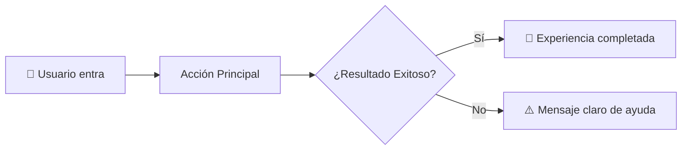

# Especificación de Producto: [Nombre de la Funcionalidad]

> ⚠️ **REGLA DE ORO DEL SPEC KIT:**  
> **PROHIBIDO incluir nombres de frameworks, librerías o tablas SQL en este documento.**  
> Aquí solo se define **QUÉ** hace el producto, **PARA QUIÉN** y **POR QUÉ**. La arquitectura técnica pertenece exclusivamente a `plan.md`.

---

## 📌 Resumen Ejecutivo para el Fundador (Sin Tecnicismos)

1. **Propósito en 1 frase:** [Qué problema resuelve esta pantalla o funcionalidad para el usuario].
2. **Valor para el negocio:** [Cómo impacta en ventas, retención o satisfacción].
3. **Experiencia del usuario:** [Qué verá y sentirá el usuario al interactuar].

### 🗺️ Flujo Visual del Usuario

---

## 🎯 1. Historias de Usuario (User Stories)

### US1: [Título de la Historia Principal] (Prioridad: P1 🎯 MVP)
> **Como** [tipo de usuario: cliente registrado, visitante, administrador]  
> **Quiero** [acción específica que realiza]  
> **Para** [beneficio o resultado obtenido]

**Criterios de Aceptación (Condiciones de Éxito):**
- [ ] **Escenario 1 (Camino Feliz):** Dado que el usuario ..., cuando ..., entonces el sistema ...
- [ ] **Escenario 2 (Validación de Datos):** Si el usuario ingresa datos incompletos o inválidos, entonces el sistema muestra ...
- [ ] **Escenario 3 (Regla de Negocio):** Si se intenta una operación no permitida, entonces el sistema responde con ...

---

## 🛡️ 2. Casos Borde y Mitigaciones (Edge Cases)
*(Sección alimentada con la habilidad `/grill-me`)*
- **CB-01 (Caída de red o servicios externos):** Qué ocurre si la conexión falla durante la acción.
- **CB-02 (Usuarios malintencionados o datos extremos):** Límites de longitud, tamaño de archivos o caracteres raros.
- **CB-03 (Cancelaciones o reembolsos):** Comportamiento si el usuario se arrepiente a mitad del proceso.

---

## 🚪 3. Fuera de Alcance (Out of Scope)
- [Funcionalidad que NO se construirá en esta versión para evitar dispersión de tiempo].

---

## 🛑 4. Compuerta de Aprobación del Fundador (Gatekeeping)
- [ ] El Fundador ha leído el **Resumen Ejecutivo** y el **Diagrama Visual**.
- [ ] El Fundador ha respondido afirmativamente: *"Aprobado para pasar a plan.md"*.
